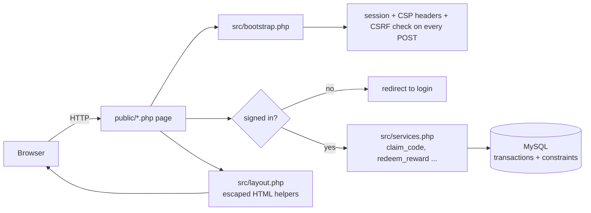
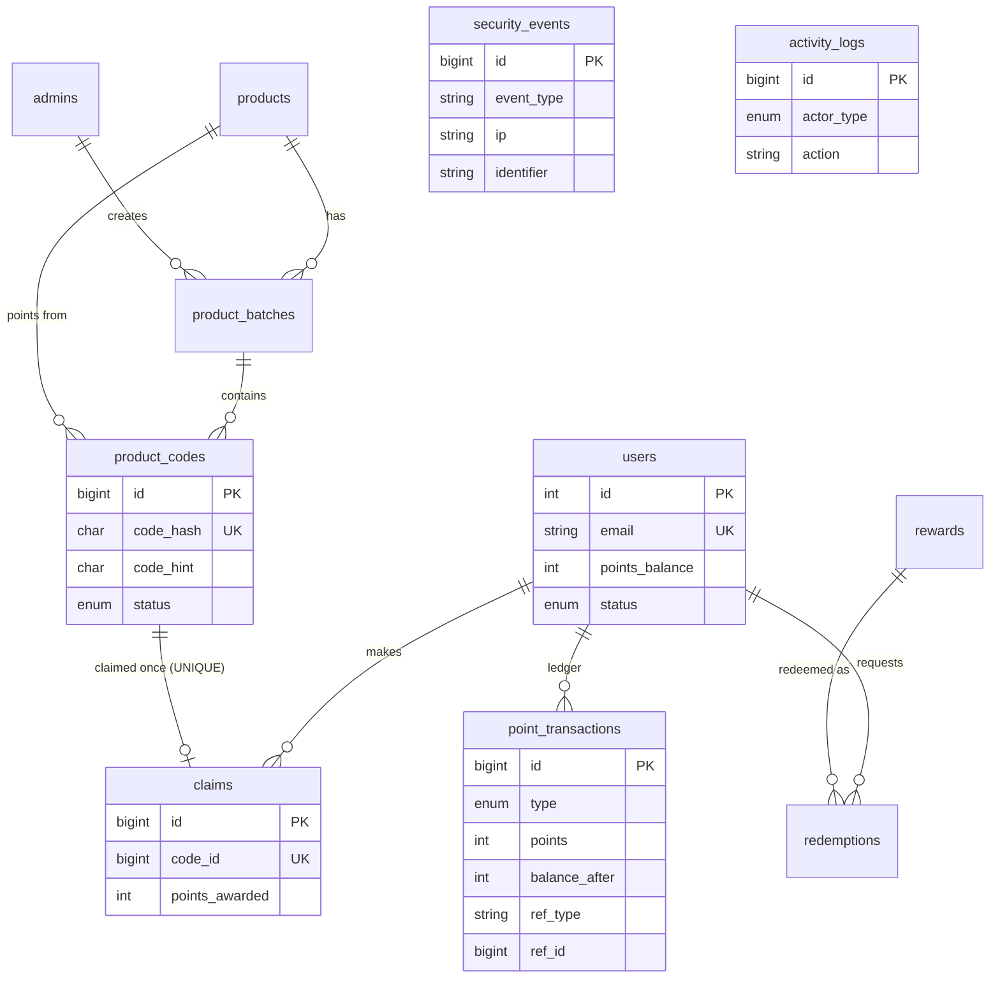

# Architecture

## Stack and why

| Choice | Reason |
|---|---|
| **PHP 8 + PDO, no framework** | Required by the brief; also small enough to read top to bottom. Every page is a short script: include `bootstrap.php`, check auth, run SQL, print HTML. |
| **MySQL/MariaDB (InnoDB)** | Needs real transactions, row locks (`SELECT … FOR UPDATE`) and UNIQUE constraints. These are what make double-claims impossible. |
| **Server-rendered pages** | Simple, works without a build step, safe by default because output is escaped in one place (`e()`). |
| **Vanilla JS (`app.js`, ~285 lines)** | Only behaviour the brief asks for: theme, mobile menu, tables, dialogs, toasts, validation. No data logic lives in the browser. |
| **`database.sql` + browser setup + `check.php`** | A non-technical user should be able to install with only XAMPP and phpMyAdmin: import one file, open the setup check, create the admin in the browser. |
| **Inline SVG chart, no Chart.js** | One small chart; avoids a CDN dependency so the app works offline. |

## Request flow



## Claiming a code (the critical path)

```mermaid
sequenceDiagram
  participant C as Customer
  participant PHP as claim_code()
  participant DB as MySQL
  C->>PHP: code "ABCD-…"
  PHP->>DB: count recent failures (rate limit)
  PHP->>PHP: normalise, HMAC-SHA256 with CODE_PEPPER
  PHP->>DB: BEGIN
  PHP->>DB: SELECT … WHERE code_hash=? FOR UPDATE   (row lock)
  alt unknown / used / inactive
    PHP->>DB: ROLLBACK
    PHP->>DB: INSERT security_events (claim_failed)
    PHP-->>C: friendly error
  else active
    PHP->>DB: UPDATE product_codes SET status='claimed' WHERE status='active'
    PHP->>DB: INSERT claims (UNIQUE code_id)
    PHP->>DB: SELECT user … FOR UPDATE; UPDATE balance
    PHP->>DB: INSERT point_transactions (ledger, UNIQUE per event)
    PHP->>DB: COMMIT
    PHP-->>C: +N points
  end
```

Four independent layers stop a double award: the row lock (concurrent claims queue up), the conditional `UPDATE … WHERE status='active'` (must change exactly 1 row), `UNIQUE(claims.code_id)`, and `UNIQUE(point_transactions.type, ref_type, ref_id)`. Redemption uses the same pattern: lock the user row, then the reward row, then conditional updates (`points_balance >= cost`, `stock > 0`) and an UNSIGNED balance column as the last line of defence.

## Data model



* `point_transactions` is an append-only ledger. `users.points_balance` is a cache of its sum, and the tests check they agree.
* `security_events` feeds both the rate limiter (counts recent rows) and the admin Security page. `activity_logs` records who did what.

## Security layers

| Concern | Measure |
|---|---|
| Guessing codes | 80-bit random codes; 5 failed claims per 15 min per account and 15 per IP; every failure logged |
| Leaked database | Only HMAC hashes of codes stored (secret key in `config/secret.key` or `.env`, never in the database); passwords with bcrypt (`password_hash`) |
| Race conditions | Transactions, row locks, conditional updates, UNIQUE constraints (see above) |
| SQL injection | PDO prepared statements, emulation off; the few interpolated names (`$table`, rate-limit field) come from fixed whitelists in code |
| XSS | Every output through `e()`; strict CSP (`script-src 'self'`, no inline scripts or event handlers) |
| CSRF | Per-session token checked on every POST in `bootstrap.php`; rotated after code generation so a refresh cannot repeat it |
| Sessions | Separate cookies for customers and admins, HttpOnly, SameSite=Lax, Secure on HTTPS, ID regenerated at login, idle timeouts |
| Login abuse | Lockout per e-mail and IP; equal timing for unknown e-mails; generic error messages |
| Web exposure | Only `public/` is meant to be served; `.htaccess` files deny `src/`, `config/`, `tests/`, `scripts/` and `.sql/.md/.key` files when the whole folder sits in `htdocs`; `check.php` verifies it |
| Error leakage | `display_errors` off; uncaught errors become a friendly page, details go to the server log |
| Audit | Ledger for points; activity log for actions; security events for failures |

## Front-end design system

`public/assets/css/app.css` defines all colours, four shadow styles (raised, raised-small, inset, inset-small), the 8/12/16/24/32/48 radius and spacing scales and the motion durations as CSS variables. `tests/css_audit.php` fails if a colour, shadow, radius or font weight is used outside those tokens. Dark mode swaps the colour variables only.
